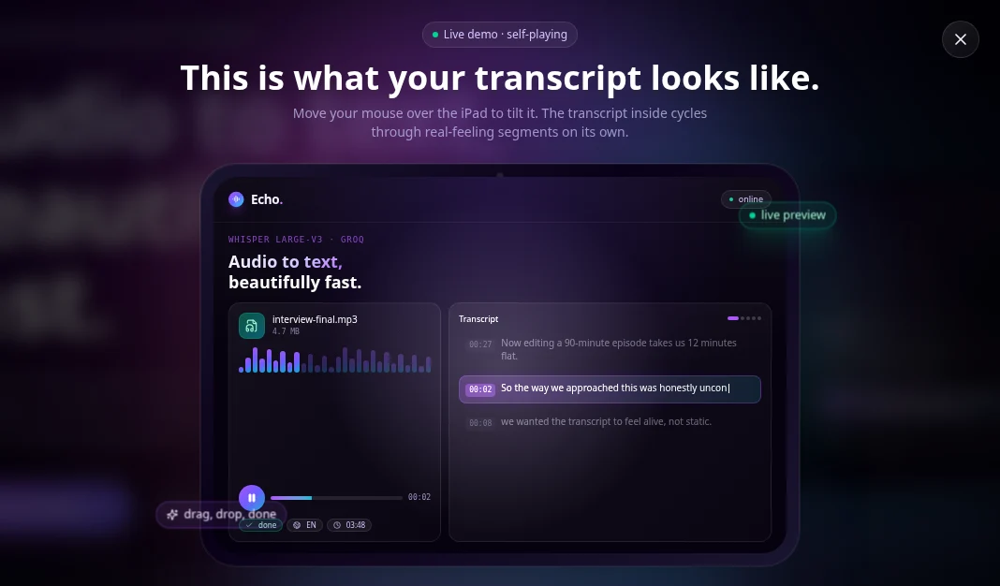

# Echo · Audio and Video Transcriber

Echo turns audio and video into timestamped transcripts and subtitle files. Upload a recording, review the text alongside media playback, and export the result as TXT, SRT, WebVTT, or JSON.



## How it works

1. The React and Vite frontend accepts an audio or video file and an optional language hint.
2. The FastAPI backend validates the file extension, enforces a 25 MiB upload limit, and sends the media to Groq’s `whisper-large-v3` model.
3. The API returns transcript text, duration, and segment and word timestamps. The browser uses the timestamps for synchronized playback and subtitle exports.

## My contributions

- Built the FastAPI upload and transcription flow, including file validation, language hints, and a response with segment and word timestamps.
- Built the React transcript viewer with synchronized media playback, click-to-seek controls, and TXT, SRT, WebVTT, and JSON exports.

## Run locally

You’ll need Python 3.10 or later, Node.js 22 or later, and a [Groq API key](https://console.groq.com/keys) to transcribe your own files.

Clone the repository and install the backend dependencies in a virtual environment.

```sh
git clone https://github.com/saadallahgharnouk-alt/transcriber_backend.git
cd transcriber_backend
python -m venv .venv
source .venv/bin/activate
python -m pip install -r requirements.txt
```

In PowerShell, activate the environment with `.venv\Scripts\Activate.ps1`.

Create a `.env` file at the repository root with `GROQ_API_KEY=your_key_here`, then start the API:

```sh
python -m uvicorn main:app --reload
```

In a second terminal, start the frontend from the repository root.

```sh
cd frontend
npm ci
npm run dev
```

Open [the app](http://localhost:5173) or [the interactive API docs](http://localhost:8000/docs). The app’s in-page demo uses sample transcript text and can be viewed with just the frontend running.

## Try the API

```sh
curl http://localhost:8000/health
curl -F 'file=@recording.mp3' -F 'language=auto' http://localhost:8000/upload
```

`POST /upload` accepts MP3, MP4, WAV, M4A, WebM, MOV, OGG, and FLAC. Groq receives the uploaded media for transcription. The local API attempts to remove its temporary upload after the request finishes. Use media you’re permitted to share.
